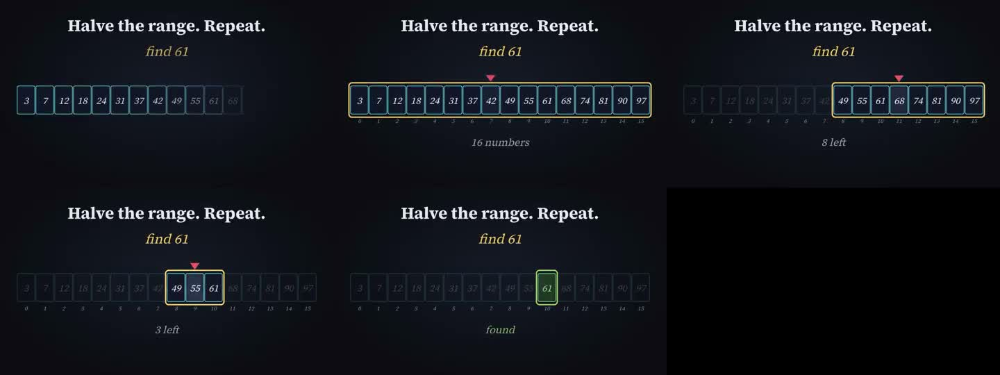
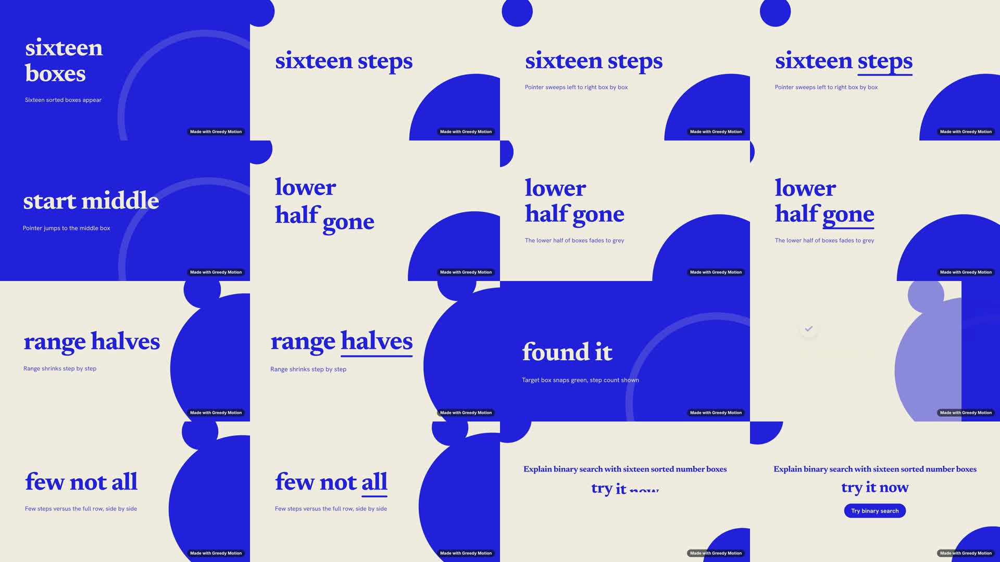

# QA: projects loading + Binary Search template, end to end (production)

Date: 2026-10-27 · Site: https://www.greedymotion.com (signed-in account, built-in browser) · Test project: `90c0e402-6b56-40d1-a2da-4fd2e4899b7a`

## Timings

| Step | Time | Notes |
|---|---|---|
| Projects page first paint | 0.14 s | Page shell only |
| `GET /projects` | 0.34 s (done at 0.48 s) | `/brands` done at 0.63 s, Supabase `/auth/v1/user` 0.85 s |
| Gap with nothing shown | ~0.35 s+ | Fixed with skeleton cards (see below) |
| Templates gallery visible | ~0.8 s | `/v1/gallery/templates` 0.11 s; 24 thumbnails ~0.04–0.6 s each |
| "Use this" → Script & style filled | ~1 s | `GET /v1/gallery/templates/binary-search` |
| Generate → project saved and plan started | 2.3 s | POST /projects 0.6 s, PUT 0.74 s, POST /plan 0.92 s (202) |
| Plan, attempt 1 | **lost** | Backend redeployed mid-plan (SIGTERM 05:46:41); UI spun for ~4.5 min, then reset silently |
| Plan, attempt 2 | **~77 s** | Two Claude calls (claude-sonnet-4-6): ~47 s + ~30 s |
| Submit video, first try | blocked | 402: needs 10.25 tokens, account had 7.5. Granted +5 (ledger `cli:osama`), balance 12.5 |
| Submit → Render step shown | 8.6 s | `POST /render` alone took 8.6 s |
| Waiting for a renderer (cold worker) | 51 s | On-demand ECS worker start |
| Preparing composition | 16 s | |
| Rendering frames | ~123 s | 1215 frames (40.5 s at 30 fps), ~9–10 frames/s |
| Adding audio and encoding | ~12 s | |
| **Submit → Review** | **3 min 31 s** | |
| Download the MP4 (13.5 MB) | 23 s | ~0.6 MB/s from the backend |
| Output | 1920×1080, h264 30 fps, AAC 48 kHz stereo, 40.5 s | Audio −19.1 dB mean / −1.9 dB peak; silent only in the last 1.3 s |

## Template selection: is Binary Search picked correctly?

**The brief is correct.** Prompt, 45 s, 16:9, smooth, calm, voiceover Kore, key-phrase captions, theme `cobalt-grid`, style `clean-data`, `styleExample: binary-search` all match `GET /v1/gallery/templates/binary-search`. The storyboard is about binary search: sixteen boxes, middle pointer, halving range, green target.

**But the saved project is mislabelled.** It stores `request.template: "product-launch"`.

## Does the final video match the template style? No.

| | Template preview (`binary-search.cb4b6d43.mp4`) | Rendered film (job `0a5fd5c2…`) |
|---|---|---|
| Ground | Dark navy | Cream with large cobalt circles (Cobalt Grid theme, with no grid visible) |
| Core visual | A row of 16 numbered boxes, a pointer, a highlighted range that halves, the target box turning green | **No boxes at all.** Big serif kinetic words ("sixteen boxes", "range halves", "found it") over decorative circles |
| On-screen text | Short labels: "find 61", "8 left", "found" | The storyboard's **stage directions** shown as subtitles ("Pointer jumps to the middle box", "The lower half of boxes fades to grey"), describing visuals that never appear |
| Ending | "found" on the green box | Product CTA: the project name as a headline plus a **"Try binary search" button** |

Root cause: the renderer only knows the beat kinds `ui | kinetic | 3d | footage | title` (`packages/contracts/src/beat-plan.ts:85`). There's no diagram or data beat. The director is told to remix the reference film (`backend/src/plan/director.ts:284-288`), including "do not follow a generic hook, success, call to action arc". It can only express the diagram as words, and the fixed beat roles (Hook…CTA) win anyway. Every "Data & diagrams" template probably renders as kinetic type, not as the diagram its preview shows. The template's assigned theme (cream Cobalt Grid) also differs from its dark preview.

## Problems found (most severe first)

0. **Template style doesn't reach the render** (see the section above). Users choose a template for its preview and get a different kind of film.
1. **Plan jobs die on a backend deploy, and the user is never told.** The plan runs in-process (`backend/src/plan/routes.ts:157-186`). A restart kills it, but `planning.status` stays `running`. The page keeps showing "Writing your script…" for about 4.5 minutes, then quietly drops back to "Ready. Generate…" with no error. Fix: on startup (or on read), mark `running` plans with no live job as `failed`/`interrupted`, and have the page show "Generation was interrupted, try again". Better still, move plans onto the job queue.
2. **Gallery template projects are saved as "Product launch" with the wrong duration.** Gallery items without a `starterId` fall back to the default template in `begin()` (`frontend/components/studio.tsx:199-201`). The project card then says "Product launch" and "0:10" (from `findTemplate(request.template)`, `studio.tsx:549`, `:652`) for a 45 s Binary Search film. The existing "Explain how the merge and sort works" card shows the same bug.
3. **The storyboard follows a product-launch arc for an educational explainer.** Beat roles were Hook / Problem / Reveal / Feature / Feature / Success / Proof / **Call to action: "Try binary search. Pick a number."** All 8 beats are "Kinetic type". There are no diagram beats, although the style is *Data & diagrams*. Worth checking whether the director gets the product-launch structure from item 2 or from its default.
4. **Duration doesn't match.** Requested 45 s; the storyboard header says 0:40; the motion-blur note says 41 s.
5. **Template thumbnails intermittently return 500** (Sketch explainer, Hairline editorial, Doodle walkthrough broke on one load and loaded later). `backend/src/gallery.ts:50` sets `Content-Type: image/webp` before the R2 fetch. When R2 errors or 404s, the JSON error is sent with an image type, and Fastify answers `500 FST_ERR_REP_INVALID_PAYLOAD_TYPE`, hiding the real error. The `immutable, max-age=1 year` header is also set before the fetch, so a failed thumbnail may get cached. Fix: set the media headers only after the object is fetched, and log the underlying R2 error.
6. **Token cost appears only after Submit.** The storyboard never shows the 10.25-token cost or the 7.5 balance. The 402 banner ("Add tokens or choose a plan.") has no button or link.
7. **Polling while generating re-downloads the whole projects list and brand kits every 2 s** (two requests every 2 s, ~10 KB each, growing with the project count). It should poll the single project, or a plan-status endpoint.
8. **The generating progress is out of view.** "Writing your script… Ns" sits in the footer below a long form. It shows no stages and no expected duration (it takes about 77 s).
9. **The style reference isn't visible.** The template's `styleExample` (binary-search) is sent to the director, but Script & style never shows it. The "Data & diagrams" example row shows Map Route, API Flow, Bar Chart and Bayes instead.
10. **`request.audio.voiceover` is `false` until the plan finishes**, even though the brief asks for a voiceover. The plan result corrects it (`routes.ts:178`), but a failed or interrupted plan leaves it wrong.
11. **Minor:** "Voice & music ready · Kore" banner though music wasn't requested; `/v1/gallery/templates` fetched twice on the Templates page; nav links (`/library`, `/brand-kits`, `/templates`, `/studio`) RSC-prefetched 3–4 times each.
13. **`POST /render` takes 8.6 s** before the page moves on. Downloading a 13.5 MB draft takes 23 s because the backend streams it at ~0.6 MB/s.
14. **The documented token grant can't run in production.** `backend/scripts/` isn't in the backend image (`/app/backend` has only `src`, `skills`, `style-library`), so `node /app/backend/scripts/tokens.ts` fails with MODULE_NOT_FOUND. I granted this time by importing `src/tokens/store.ts` directly.
15. **Review not exercised beyond loading.** Player, timeline (8 scenes, 0:40), comment box, Download and Approve all render. I didn't add or apply a comment (applying spends tokens on a re-render) or approve (final).
12. **Observability:** the production backend logs record only HTTP requests and Claude usage. Plan start, finish and failure aren't logged, so item 1 is invisible server-side.

## Fixed in this session

- **Projects skeleton** (`frontend/components/studio.tsx`, `frontend/app/styles.css`): while projects load, the grid shows three shimmering placeholder cards shaped like project cards, instead of the single "Loading your projects…" line. Filter counts stay hidden instead of reading 0. Respects reduced motion. Typecheck passes; checked visually on the live page by injecting the same markup and CSS. Not deployed.

